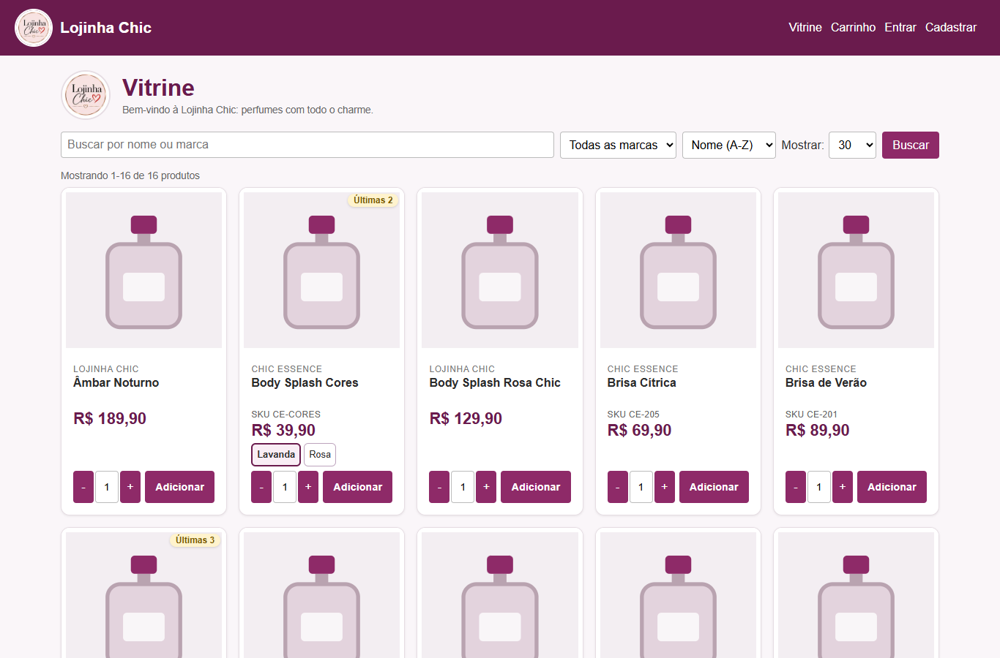
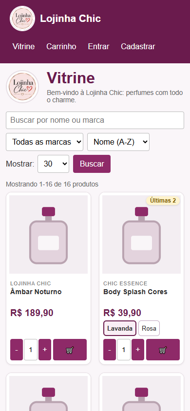
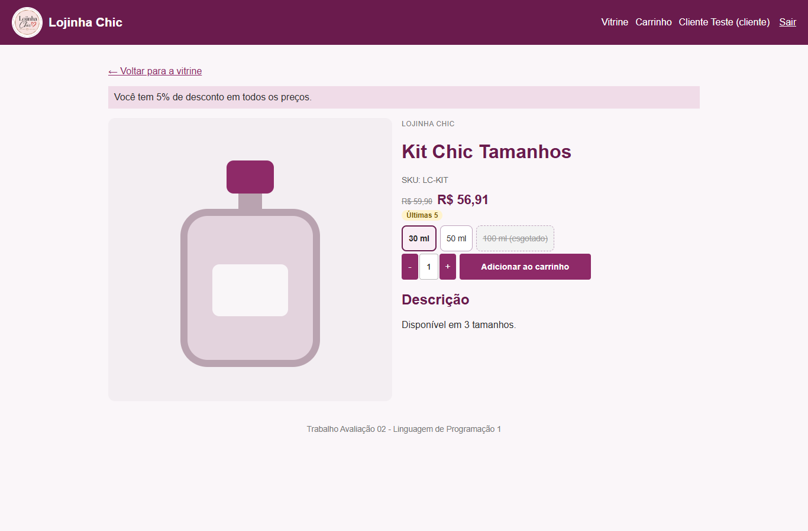
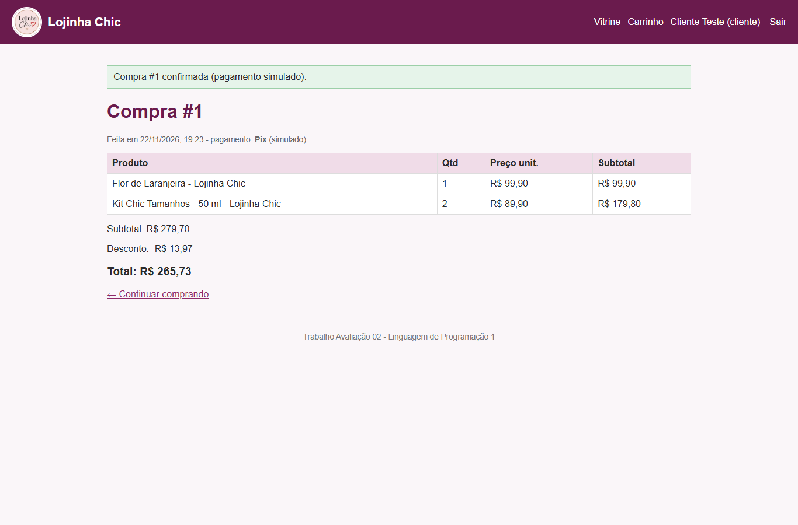
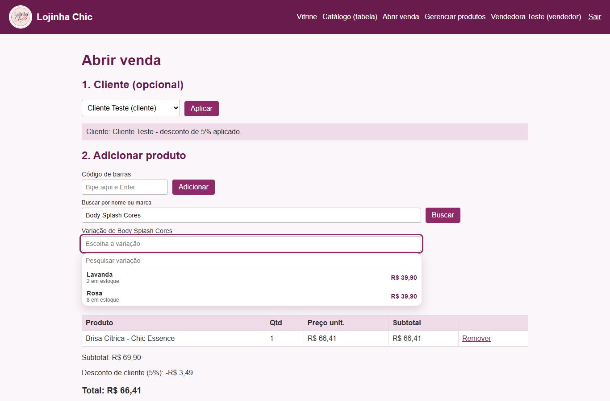
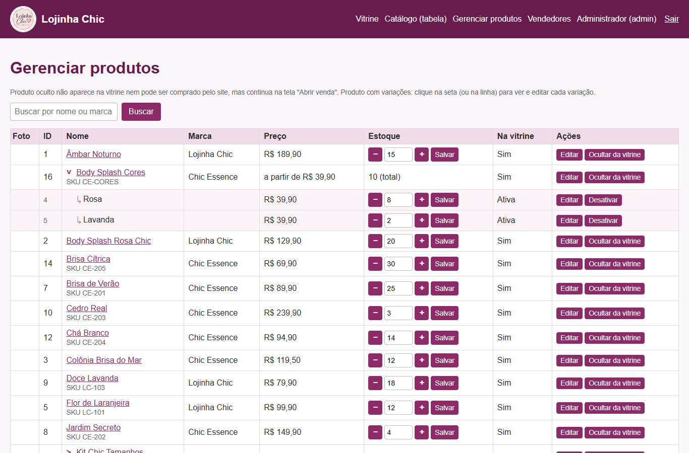
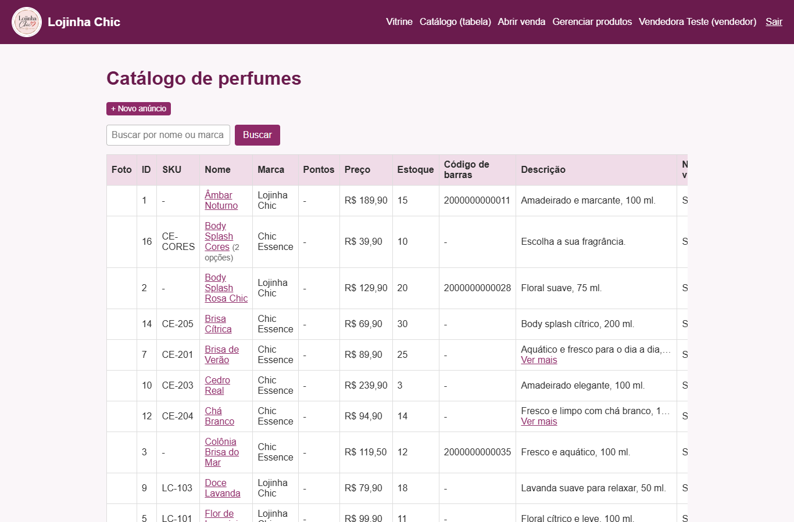
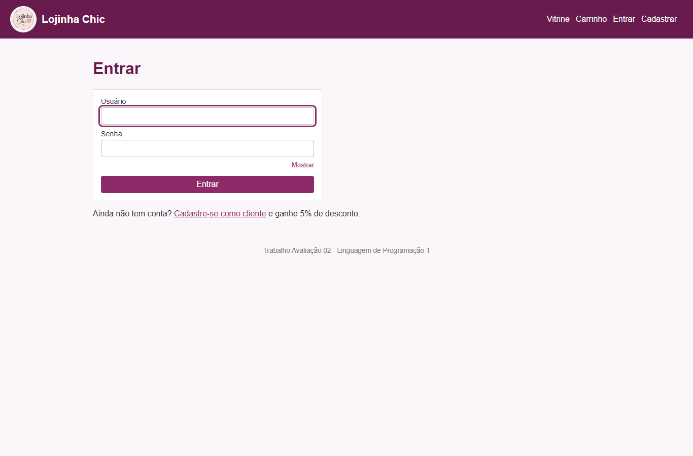
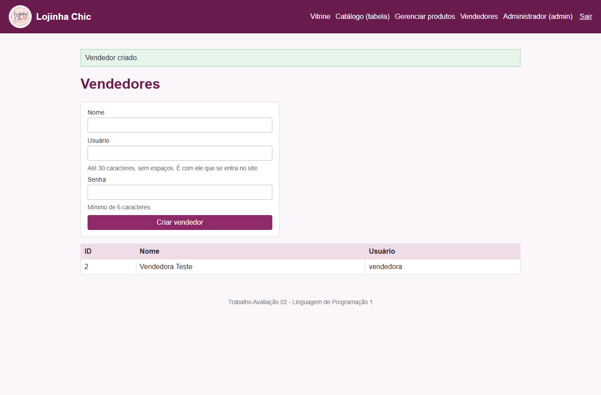

# Lojinha Chic - Loja de Perfumes

[](https://github.com/JoaoFinotiDev/Perfumes/actions/workflows/ci.yml)

Loja virtual de perfumes feita com **Node.js, Express, EJS, CSS e MySQL**: vitrine, carrinho com 5% de desconto para clientes, venda no balcão com código de barras e gestão de produtos com variações. Trabalho Avaliação 02 da disciplina **Linguagem de Programação 1**.

| | |
|---|---|
| **Integrantes** | João Vitor Vieira Finoti e João Pedro Camargo Machado |
| **Disciplina** | Linguagem de Programação 1 |
| **Professor** | Leandro Luis Pauro |

> O nome do banco (`loja_perfumes`), a pasta e o repositório ficaram com o nome antigo para não quebrar nada.



## Sumário

1. [Tecnologias](#tecnologias)
2. [Como rodar](#como-rodar)
3. [Usuários para testar](#usuários-para-testar)
4. [Funcionalidades por papel](#funcionalidades-por-papel)
5. [Rotas e quem pode usar](#rotas-e-quem-pode-usar)
6. [Onde estão os requisitos do PDF](#onde-estão-os-requisitos-do-pdf)
7. [Telas](#telas)
8. [Arquitetura, POO e SOLID](#arquitetura-poo-e-solid)
9. [Prévia do link (LinkedIn, WhatsApp)](#prévia-do-link-linkedin-whatsapp)
10. [Importadores (Mawwal e Queen)](#importadores-mawwal-e-queen)
11. [Testes](#testes)
12. [Limites conhecidos](#limites-conhecidos)
13. [Histórico](#histórico)

## Tecnologias

| Parte | Tecnologia |
|---|---|
| Servidor | Node.js 18+ e Express |
| Telas | EJS (HTML gerado no servidor) |
| Visual | CSS puro (`public/stylesheets/style.css`) e JavaScript puro no navegador, sem biblioteca |
| Banco | MySQL com o pacote `mysql2` |
| Login | `express-session` com a sessão guardada no MySQL (`express-mysql-session`) e senhas com `bcryptjs` |
| Configuração | `dotenv` (arquivo `.env`) |
| Testes | `node --test` (sem banco e sem rede) e `tests/e2e.js` (com o servidor no ar) |

## Como rodar

Precisa do Node.js 18+ e do MySQL ligado.

```bash
# 1) Dependências
npm install

# 2) Banco: cria o banco loja_perfumes, as tabelas, o admin e os produtos de exemplo
mysql -u root -p < script.sql

# 3) Migrações, EM ORDEM. Só são necessárias num banco criado ANTES delas
#    (o script.sql novo já tem tudo). Podem rodar de novo: não apagam nada.
mysql -u root -p < migracoes/001-visivel.sql
mysql -u root -p < migracoes/002-variacoes-sku-pontos.sql
mysql -u root -p < migracoes/003-sessoes.sql

# 4) Configuração: copie o exemplo e preencha (no Windows: copy .env.example .env)
cp .env.example .env

# 5) Subir o servidor
npm start          # modo normal
npm run dev        # desenvolvimento: o nodemon reinicia ao salvar um .js do servidor
```

Abra http://localhost:3000.

Variáveis do `.env` (o modelo está em `.env.example`; o `.env` nunca vai para o GitHub):

| Variável | Para que serve |
|---|---|
| `DB_HOST`, `DB_USER`, `DB_PASSWORD`, `DB_NAME` | Conexão com o MySQL (lidas por `config/db.js`) |
| `SESSION_SECRET` | Segredo que assina o cookie de login. Em produção (`NODE_ENV=production`) o app não sobe sem ele. Em desenvolvimento, vazio, o app cria um segredo fixo em `.segredo-dev` (fora do git) |
| `KODEBAR_TOKEN` | Opcional. Busca de dados pelo código de barras no cadastro de produto |
| `SITE_URL` | Opcional. Endereço usado na prévia do link (veja [Prévia do link](#prévia-do-link-linkedin-whatsapp)) |

## Usuários para testar

| Papel | Como conseguir |
|---|---|
| **Admin** | Usuário `admin`, senha `admin` (criado pelo `script.sql`). |
| **Vendedor** | Entre como Admin, abra **Vendedores** e preencha nome, usuário e senha (mínimo 6). |
| **Cliente** | Clique em **Cadastrar** no topo. O cliente já entra logado. |

> A senha `admin` é pública (está no `script.sql`). Use este acesso só para testar e avaliar o trabalho.

## Funcionalidades por papel

| Funcionalidade | Visitante | Cliente | Vendedor | Admin |
|---|:---:|:---:|:---:|:---:|
| Vitrine: busca, filtro por marca, ordem e paginação (30/50/100) | Sim | Sim | Sim | Sim |
| Página do produto com variações (chips) e zoom da foto | Sim | Sim | Sim | Sim |
| Desconto de 5% (preço antigo riscado, "Você economizou") | - | Sim | - | - |
| Carrinho: quantidade editável (até o estoque) e compra simulada | Vai para o login | Sim | - | - |
| Comprovante da compra (`/compras/:id`), só do dono | - | Sim | - | - |
| Tabela `GET /itens` | - | - | Sim | Sim |
| Novo anúncio `POST /itens` | - | - | Sim | - |
| Gerenciar produtos: variações, estoque compacto, ocultar/mostrar, editar | - | - | Sim | Sim |
| Abrir venda no balcão (código de barras, busca, cliente opcional) | - | - | Sim | - |
| Criar vendedores | - | - | - | Sim |

Depois do login, a pessoa volta para a página que pediu o login (por exemplo, o produto que tentou pôr no carrinho). Só vale caminho deste site: `utils/caminho.js` recusa `//outro-site` e endereços externos.

## Rotas e quem pode usar

Quem barra é o servidor (`middlewares/auth.js`): visitante vai para o login e papel errado recebe **403**. O menu só esconde os links.

| Rotas | Quem entra |
|---|---|
| `GET /`, `GET /produto/:id`, `GET /api/produtos` | Todos (produto oculto só para Vendedor/Admin) |
| `GET/POST /login`, `GET/POST /cadastro`, `POST /logout` | Todos |
| `/carrinho`, `/carrinho/adicionar`, `/carrinho/quantidade`, `/carrinho/remover`, `/carrinho/finalizar` | Só Cliente |
| `GET /compras/:id` | Só Cliente, e só o dono da compra (os outros recebem 404) |
| `GET /itens` | Vendedor e Admin |
| `POST /itens` | Só Vendedor |
| `/vendedor/produtos/...` (lista, editar, estoque, visibilidade, variações) | Vendedor e Admin |
| `/vendedor/venda/...`, `GET /api/produto-por-codigo/:codigo` | Só Vendedor |
| `/admin`, `POST /admin/vendedores` | Só Admin |
| Qualquer outro endereço | Página 404 com botão "Voltar à vitrine" |

## Onde estão os requisitos do PDF

| Requisito | Onde |
|---|---|
| `script.sql` | [`script.sql`](script.sql): banco, tabelas, admin e produtos de exemplo das marcas fictícias "Lojinha Chic" e "Chic Essence" |
| Conexão com o banco | [`config/db.js`](config/db.js): pool do `mysql2`, dados vindos do `.env` |
| `.env.example` | [`.env.example`](.env.example) |
| `GET /itens` | [`routes/index.js`](routes/index.js) -> [`controllers/CatalogoController.js`](controllers/CatalogoController.js) -> página EJS com tabela em [`views/itens.ejs`](views/itens.ejs). **Exige login de Vendedor ou Admin**: visitante vai para o login e Cliente recebe 403. |
| `POST /itens` | Mesma rota. O formulário fica em `/itens` para o Vendedor (atalho "+ Novo anúncio" no topo). O servidor valida tudo em [`services/GestaoProdutosService.js`](services/GestaoProdutosService.js). |
| CSS | [`public/stylesheets/style.css`](public/stylesheets/style.css) |
| README e GitHub | Este arquivo, no repositório [JoaoFinotiDev/Perfumes](https://github.com/JoaoFinotiDev/Perfumes) |

## Telas

Prints feitos num banco de teste, com produtos fictícios e a imagem padrão da loja (sem fotos de terceiros nem dados de clientes reais). Computador com 1366px de largura e celular com 390px.

| Vitrine no celular | Página do produto |
|---|---|
|  |  |

| Carrinho | Comprovante da compra |
|---|---|
|  |  |

**Abrir venda (Vendedor):** cliente escolhido (5% de desconto) e a 2ª busca para escolher a variação.



**Gerenciar produtos:** variações abertas embaixo do produto e o estoque compacto `[ − ] [ campo ] [ + ] [Salvar]`.



**Catálogo `GET /itens`:** a tabela pedida no PDF, com o atalho "+ Novo anúncio".



| Login | Admin: vendedores | Página 404 |
|---|---|---|
|  |  |  |

O que cada tela faz:

- **Vitrine (`/`)**: cards com foto, marca, nome e preço. Filtro de marca, ordem e "Mostrar 30/50/100" aplicam ao escolher. Sem resultado aparece "Nenhum perfume encontrado." e o botão "Limpar filtros". O título da aba muda com a busca.
- **Busca em lista**: ao clicar no campo, abre uma lista que filtra a cada letra. Setas andam, Enter escolhe, Esc fecha. Os dados vêm de `GET /api/produtos`, uma rota local.
- **Página do produto**: chips de variação trocam preço e "Últimas N". Clicar na foto abre uma janela com zoom (Esc fecha).
- **Carrinho**: quantidade editável, limitada ao estoque no servidor; "Você economizou R$ X"; "Continuar comprando". O botão "Finalizar compra" trava depois do clique.
- **Comprovante (`/compras/:id`)**: itens, preços gravados na venda, desconto, total e forma de pagamento. Só o dono vê.
- **Gerenciar produtos**: a seta abre as variações; cada uma tem estoque compacto, Ativar/Desativar e Editar. Variação inativa some da vitrine e de "Abrir venda", mas continua aqui.
- **Celular**: tabelas rolam dentro de uma caixa, o menu do topo fica numa linha que rola para o lado e os botões têm 44px.
- **Acessibilidade**: foco visível no Tab, avisos de erro em vermelho com `role="alert"`, sucesso em verde com `role="status"`, botão "Mostrar senha" no login e no cadastro.
- **Código de barras**: no cadastro de produto, preenche nome, marca e foto pela API Kodebar (`KODEBAR_TOKEN`) e, se não achar, pelo Open Beauty Facts. Se a busca falhar, nada fica guardado no cache e dá para tentar de novo.

## Arquitetura, POO e SOLID

O pedido passa por camadas, e cada uma faz só a sua parte:

```
routes -> middlewares -> controllers -> services -> domain + repositories -> config/db.js (MySQL)
```

```
.
├── app.js, bin/www         servidor Express (views, sessão, rotas)
├── container.js            cria os objetos e entrega um para o outro (injeção de dependência)
├── config/                 db.js (pool MySQL), sessao.js (login no MySQL), segredo.js (SESSION_SECRET)
├── routes/                 index.js, produtos.js, vendedor.js, admin.js
├── middlewares/            auth.js (papéis, aviso, usuário), erros.js (página de erro)
├── controllers/            só HTTP: lê o pedido, chama o service, responde
├── services/               PerfumeService (consultas comuns), VitrineService, GestaoProdutosService,
│                           CarrinhoService, VendaService, AuthService
├── domain/                 Perfume, Variacao, Carrinho, Venda, Usuario, Desconto, Paginacao
├── repositories/           todo o SQL, com parâmetros (?)
├── buscadores/             busca por código de barras (Kodebar, Open Beauty Facts, cadeia, cache)
├── utils/                  validacao, moeda, erros, aviso, caminho, html, ligar
├── views/                  telas EJS (partials/ com topo, rodapé, compra do card e tabela do carrinho)
├── public/                 CSS, JavaScript do navegador e imagens
├── scripts/                importadores de catálogo (Mawwal e Queen)
├── migracoes/              mudanças para bancos já existentes (001, 002, 003)
├── tests/                  testes sem banco (*.test.js) e o e2e.js
└── docs/prints/            prints deste README
```

Exemplos de POO e SOLID no código:

1. **`domain/Usuario.js`** (herança e polimorfismo): `Cliente`, `Vendedor` e `Admin` herdam de `Usuario`. O sistema pergunta ao objeto (`ehCliente()`, `podeGerenciar()`, `estrategiaDesconto()`) em vez de comparar texto. Os nomes dos papéis ficam só em `PAPEIS`.
2. **`domain/Desconto.js`** (Strategy, aberto/fechado): `SemDesconto` e `DescontoCliente` herdam de `EstrategiaDesconto`. Um desconto novo é uma classe nova; o "5%" das telas vem de `emPorcento()`.
3. **`services/`** (responsabilidade única): o antigo `PerfumeService` foi dividido. `PerfumeService` tem só as consultas comuns; `VitrineService` cuida do que o comprador vê; `GestaoProdutosService` cuida de criar, editar, estoque e variações.
4. **`container.js`** (inversão de dependência): controllers e services recebem o que usam pelo construtor. Os testes trocam o banco por um repositório falso.
5. **`buscadores/BuscadorEmCadeia.js`** (substituição de Liskov): `KodebarBuscador` e `OpenBeautyFactsBuscador` têm o mesmo `buscar(codigo)` e podem ser trocados ou encadeados. `BuscadorComCache` embrulha qualquer um deles.

## Prévia do link (LinkedIn, WhatsApp)

Cada página tem as meta tags Open Graph e Twitter (título, descrição e logo). Essas redes pedem o endereço **completo** da imagem, que vem de `SITE_URL`:

- `SITE_URL` é **opcional**. Vazio, o site usa o endereço que chegou no pedido (ex.: `http://localhost:3000` no seu PC).
- Para a prévia funcionar **fora da sua rede**, coloque o endereço que abre de fora, por exemplo `SITE_URL=http://IP-EXTERNO:3000` (troque `IP-EXTERNO` pelo IP externo da máquina que roda o site).
- A prévia do LinkedIn **só aparece se esse endereço abrir pela internet**. Se não abrir, o post mostra só o texto ou o vídeo.

## Importadores (Mawwal e Queen)

Scripts opcionais para encher o catálogo com produtos reais. Eles **só adicionam**, nunca apagam, e podem rodar de novo. Os dois usam a classe comum `scripts/importador-de-catalogo.js`.

| Comando | Fonte | Observações |
|---|---|---|
| `npm run importar:mawwal` | Lista pública `mawwal.com.br/products.json` | Estoque padrão 10. `-- --salvar=mawwal.json` guarda o JSON e `-- --arquivo=mawwal.json` importa sem rede. `--corrigir-descricoes` conserta textos com `&...;`. |
| `npm run importar:queen -- --arquivo=queen-produtos.json` | Catálogo da Queen Semijoias na plataforma Conecta Venda | Precisa da migração 002. Cria variações, SKU e pontos (só a marca Queen tem pontos). Sem `--arquivo`, baixa da internet. |

**Nota de fonte:** os dados e as fotos importados pertencem a Mawwal Arabia Brasil e a Queen Semijoias. O uso é só acadêmico, e esses produtos **não** ficam no `script.sql`.

## Testes

```bash
npm test                                 # todos os tests/*.test.js: regras, services, views e rotas, sem banco e sem rede
npm run e2e                              # ponta a ponta: precisa do servidor no ar e do banco com o script.sql
npm run e2e -- http://localhost:3100     # o e2e aceita outro endereço
```

- `npm test` acha sozinho todo arquivo `tests/*.test.js` (não há lista para manter).
- O `tests/e2e.js` usa só o servidor local e o MySQL. Ele não chama nenhuma API externa e cria usuários e vendas de teste no banco configurado, então rode num **banco de teste**.
- O GitHub Actions (badge no topo) roda `node --check` em todos os `.js` e o `npm test` a cada push e PR.

## Limites conhecidos

Trabalho acadêmico. Para uma versão de produção faltariam:

- **Senha do admin**: é `admin` e é pública. Serve para a avaliação; num site de verdade seria trocada no primeiro acesso.
- **CSRF**: os formulários não têm token. A proteção é o cookie com `sameSite: 'lax'`.
- **Tentativas de login**: não há limite. Em produção, limitar por IP ou usuário.
- **Pagamento**: é só simulado.
- **Carrinho**: cada linha faz uma consulta ao banco. Bom para carrinhos pequenos.
- **Permissão de produto**: qualquer Vendedor edita qualquer produto (a loja é uma só). A regra fica em `Usuario.podeGerenciar()`.
- **Prévia do link**: depende de um endereço que abra pela internet (veja `SITE_URL`).
- **Zoom da foto**: usa `<dialog>`; num navegador sem ele, o link só abre a foto inteira.

## Histórico

- Pull requests fechados: [lista de PRs fechados](https://github.com/JoaoFinotiDev/Perfumes/pulls?q=is%3Apr+is%3Aclosed)
- Histórico de commits: [commits da main](https://github.com/JoaoFinotiDev/Perfumes/commits/main)
