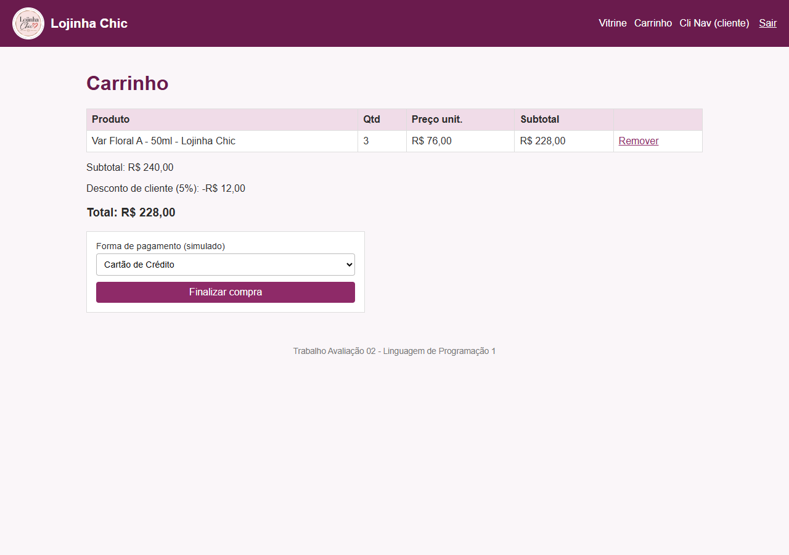
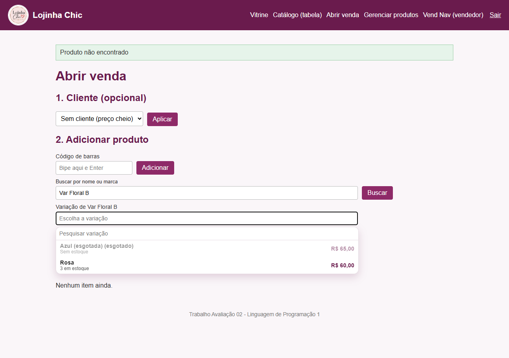
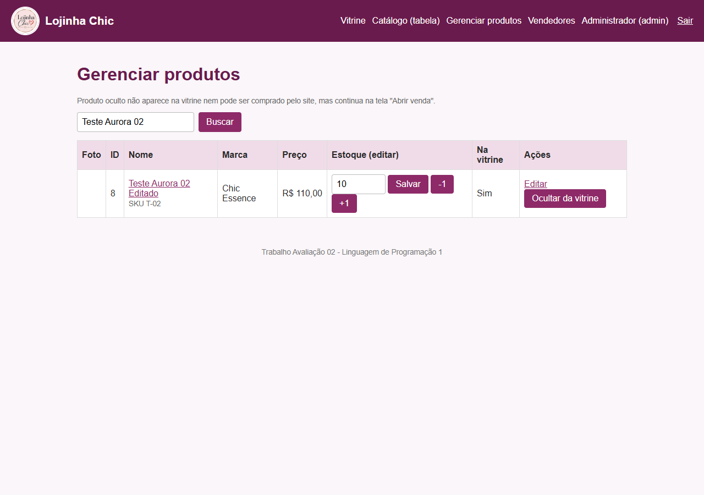
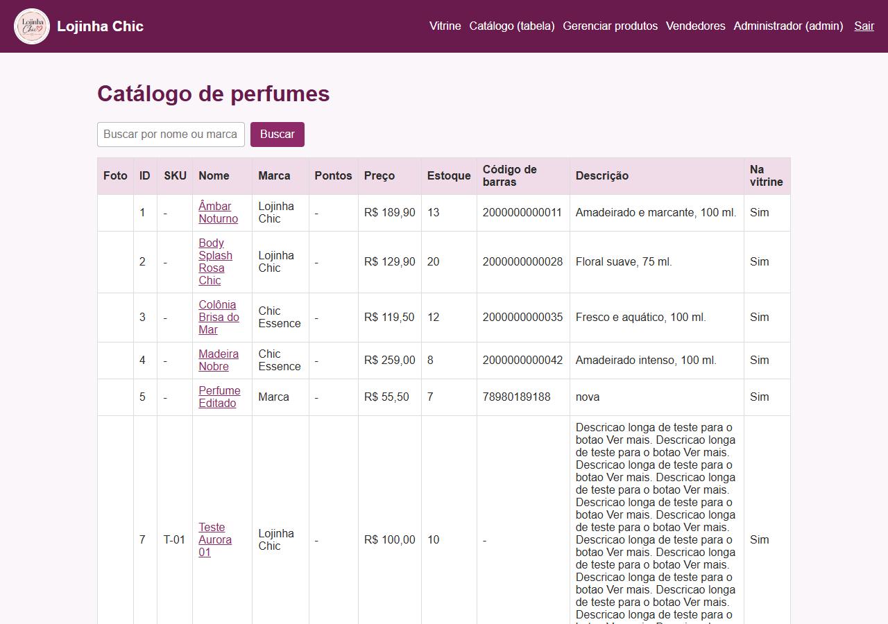

# Lojinha Chic - Loja de Perfumes

Trabalho Avaliação 02 da disciplina **Linguagem de Programação 1**.

| | |
|---|---|
| **Tema** | Loja de perfumes estilo marketplace: vitrine, carrinho, login de Cliente, Vendedor e Admin, venda no balcão com código de barras |
| **Integrantes** | João Vitor Vieira Finoti e João Pedro Camargo Machado |
| **Disciplina** | Linguagem de Programação 1 |
| **Professor** | Leandro Luis Pauro |

> O nome do banco (`loja_perfumes`), a pasta e o repositório ficaram com o nome antigo para não quebrar nada.


## Sumário

1. [Tecnologias](#tecnologias)
2. [Como instalar e rodar](#como-instalar-e-rodar)
3. [Usuários para testar](#usuários-para-testar)
4. [Funcionalidades por papel](#funcionalidades-por-papel)
5. [Onde estão os requisitos do PDF](#onde-estão-os-requisitos-do-pdf)
6. [Arquitetura, POO e SOLID](#arquitetura-poo-e-solid)
7. [Telas](#telas)
8. [Importadores (Mawwal e Queen)](#importadores-mawwal-e-queen)
9. [Testes](#testes)
10. [Limites conhecidos](#limites-conhecidos)
11. [Histórico](#histórico)

## Tecnologias

| Parte | Tecnologia |
|---|---|
| Servidor | Node.js 18+ e Express |
| Telas | EJS (HTML gerado no servidor) |
| Visual | CSS puro (`public/stylesheets/style.css`) e JavaScript puro no navegador, sem biblioteca |
| Banco | MySQL com o pacote `mysql2` |
| Login | `express-session` com a sessão guardada no MySQL (`express-mysql-session`) e senhas com `bcryptjs` |
| Configuração | `dotenv` (arquivo `.env`) |

## Como instalar e rodar

Precisa do Node.js 18+ e do MySQL ligado.

```bash
# 1) Dependências
npm install

# 2) Banco: cria o banco loja_perfumes, as tabelas e os produtos de exemplo
mysql -u root -p < script.sql

# 3) Migrações, EM ORDEM (só para banco criado antes delas; podem rodar de novo sem apagar nada)
mysql -u root -p < migracoes/001-visivel.sql
mysql -u root -p < migracoes/002-variacoes-sku-pontos.sql
mysql -u root -p < migracoes/003-sessoes.sql

# 4) Configuração: copie o exemplo e preencha (no Windows: copy .env.example .env)
cp .env.example .env

# 5) Subir o servidor
npm start          # modo normal
npm run dev        # desenvolvimento: o nodemon reinicia ao salvar um .js do servidor
```

Abra http://localhost:3000.

O `.env` tem `DB_HOST`, `DB_USER`, `DB_PASSWORD`, `DB_NAME`, `SESSION_SECRET` e `KODEBAR_TOKEN` (opcional). Ele nunca vai para o GitHub.

**Antes de publicar:** preencha `SESSION_SECRET` com um texto longo e aleatório. Com `NODE_ENV=production` o app não sobe sem ele. Em desenvolvimento, sem ele, o app cria um segredo no arquivo `.segredo-dev` (fora do git).

## Usuários para testar

| Papel | Como conseguir |
|---|---|
| **Admin** | Usuário `admin`, senha `admin` (criado pelo `script.sql`). **Troque essa senha** antes de publicar: ela está no repositório. |
| **Vendedor** | Entre como Admin, abra o menu **Vendedores** e preencha nome, usuário e senha (mínimo 6). |
| **Cliente** | Clique em **Cadastrar** na barra do topo. O cliente já entra logado. |

## Funcionalidades por papel

| Funcionalidade | Visitante | Cliente | Vendedor | Admin |
|---|:---:|:---:|:---:|:---:|
| Vitrine, busca, filtro por marca, ordem e paginação (30/50/100) | Sim | Sim | Sim | Sim |
| Página do produto com variações (chips) | Sim | Sim | Sim | Sim |
| Desconto de 5% (preço antigo riscado) | - | Sim | - | - |
| Carrinho e compra simulada (Pix, crédito, débito, dinheiro) | Vai para o login | Sim | - | - |
| Tabela `GET /itens` | - | - | Sim | Sim |
| Novo anúncio `POST /itens` | - | - | Sim | - |
| Gerenciar produtos: editar, variações, estoque -1/+1, ocultar/mostrar | - | - | Sim | Sim |
| Abrir venda no balcão (código de barras, busca, cliente opcional) | - | - | Sim | - |
| Criar vendedores | - | - | - | Sim |

Quem barra de verdade é o servidor (middlewares `exigirCliente` e `exigirPapel` em `middlewares/auth.js`). O menu só esconde os links.

## Onde estão os requisitos do PDF

| Requisito | Onde |
|---|---|
| `script.sql` | `script.sql` (banco, tabelas e dados de exemplo das marcas fictícias "Lojinha Chic" e "Chic Essence") |
| Conexão com o banco | `config/db.js` (pool do `mysql2`, dados vindos do `.env`) |
| `.env.example` | `.env.example` |
| `GET /itens` | `routes/index.js` -> `controllers/CatalogoController.js` -> página EJS com tabela em `views/itens.ejs`. **Exige login de Vendedor ou Admin**: visitante vai para o login e Cliente recebe 403. |
| `POST /itens` | Mesma rota. O formulário aparece em `/itens` para o Vendedor. O servidor valida tudo (`services/PerfumeService.js`, método `_validar`). |
| CSS | `public/stylesheets/style.css` |
| README e GitHub | Este arquivo, no repositório [JoaoFinotiDev/Perfumes](https://github.com/JoaoFinotiDev/Perfumes) |

## Arquitetura, POO e SOLID

O pedido passa por camadas. Cada uma faz só a sua parte:

```
routes -> middlewares -> controllers -> services -> domain + repositories -> config/db.js (MySQL)
```

| Camada | Pasta | Trabalho |
|---|---|---|
| Rotas | `routes/` | Liga o endereço ao controller e ao middleware de papel |
| Controllers | `controllers/` | Só HTTP: lê o pedido, chama o service, responde |
| Services | `services/` | Regras do caso de uso (carrinho, venda, produtos, login) |
| Domínio | `domain/` | Classes com as regras: `Perfume`, `Variacao`, `Carrinho`, `Venda`, `Usuario`, `Desconto`, `Paginacao` |
| Repositórios | `repositories/` | Todo o SQL, com consultas parametrizadas (`?`) |
| Montagem | `container.js` | Cria os objetos e entrega um para o outro (injeção de dependência) |

Exemplos de POO e SOLID no código:

1. **`domain/Usuario.js`** (herança e polimorfismo): `Cliente`, `Vendedor` e `Admin` herdam de `Usuario`. Cada um responde do seu jeito a `estrategiaDesconto()`, `podeGerenciar()` e `podeUsarCarrinho()`. Ninguém precisa de `if (papel === ...)` espalhado.
2. **`domain/Desconto.js`** (Strategy, aberto/fechado): `SemDesconto` e `DescontoCliente` herdam de `EstrategiaDesconto`. Um desconto novo é uma classe nova, sem mexer no carrinho.
3. **`container.js`** (inversão de dependência): os controllers e services recebem o que usam pelo construtor. Os testes trocam o banco por um repositório falso.
4. **`buscadores/BuscadorEmCadeia.js`** (substituição de Liskov): `KodebarBuscador` e `OpenBeautyFactsBuscador` têm o mesmo método `buscar(codigo)` e podem ser trocados ou encadeados. `BuscadorComCache` embrulha qualquer um deles.
5. **`repositories/VendaRepository.js`** (responsabilidade única): só grava a venda e baixa o estoque, numa transação. A regra do total fica em `domain/Venda.js`.

## Telas

| Vitrine no celular | Carrinho com desconto de 5% |
|---|---|
|  |  |

**Abrir venda (Vendedor):** produto com variação abre uma 2ª busca, e a variação esgotada aparece desativada.



**Gerenciar produtos:** estoque -1/+1, editar e ocultar/mostrar na vitrine.



**`GET /itens`:** a tabela pedida no PDF, com o botão "Ver mais" para descrições longas.



Os prints usam só produtos de exemplo de um banco de teste, com a imagem padrão da loja.

Detalhes das telas:

- **Vitrine (`/`)**: cards com foto, marca, nome e preço. Filtro de marca, ordem e "Mostrar 30/50/100" aplicam ao escolher. A paginação fica em `domain/Paginacao.js`.
- **Busca em lista**: ao clicar no campo, abre uma lista que filtra a cada letra. Setas andam, Enter escolhe, Esc fecha. Os dados vêm de `GET /api/produtos`, uma rota local (só o nosso banco).
- **Variações**: um produto pode ter tamanhos ou cores, cada um com preço e estoque. Os chips trocam o preço e o aviso "Últimas N". O campo de quantidade vai até o estoque.
- **Carrinho**: o servidor confere tudo de novo. Se passar do estoque, avisa quantos já estão no carrinho, por exemplo: "Você já tem 3 de "X" no carrinho e só temos 3 em estoque."
- **Código de barras**: no cadastro de produto, preenche nome, marca e foto pela API Kodebar (`KODEBAR_TOKEN`) e, se não achar, pelo Open Beauty Facts. Sem token ou sem internet, basta digitar.
- **Sessão no MySQL**: reiniciar o servidor não tira ninguém do login (8 horas; "Sair" apaga a sessão).

## Importadores (Mawwal e Queen)

Scripts opcionais para encher o catálogo com produtos reais. Eles **só adicionam**, nunca apagam, e podem rodar de novo. Os dois usam a classe comum `scripts/importador-de-catalogo.js`.

| Comando | Fonte | Observações |
|---|---|---|
| `npm run importar:mawwal` | Lista pública `mawwal.com.br/products.json` | Estoque padrão 10. `-- --salvar=mawwal.json` guarda o JSON e `-- --arquivo=mawwal.json` importa sem rede. `--corrigir-descricoes` conserta textos com `&...;`. |
| `npm run importar:queen -- --arquivo=queen-produtos.json` | Catálogo da Queen Semijoias na plataforma Conecta Venda | Precisa da migração 002. Cria variações, SKU e pontos (só a marca Queen tem pontos). Sem `--arquivo`, baixa da internet. |

**Nota de fonte:** os dados e as fotos importados pertencem a Mawwal Arabia Brasil e a Queen Semijoias. O uso é só acadêmico, e esses produtos **não** ficam no `script.sql`.

## Testes

```bash
npm test        # regras de domínio, services e views, sem banco e sem internet
npm run e2e     # ponta a ponta: precisa do servidor no ar e do banco com o script.sql
npm run e2e -- http://localhost:3100   # o e2e aceita outro endereço
```

O `tests/e2e.js` usa só o servidor local e o MySQL. Ele não chama nenhuma API externa e cria usuários e vendas de teste no banco configurado, então rode num banco de teste.

## Limites conhecidos

Trabalho acadêmico. Para uma versão de produção faltariam:

- **CSRF**: os formulários não têm token. A proteção é o cookie com `sameSite: 'lax'`.
- **Tentativas de login**: não há limite. Em produção, limitar por IP ou usuário.
- **Carrinho**: cada linha faz uma consulta ao banco. Bom para carrinhos pequenos.
- **Pagamento**: é só simulado.
- **Permissão de produto**: qualquer Vendedor edita qualquer produto (a loja é uma só). A regra fica em `Usuario.podeGerenciar()`.

## Histórico

- Lista de pull requests fechados: [PRs fechados](https://github.com/JoaoFinotiDev/Perfumes/pulls?q=is%3Apr+is%3Aclosed)
- Todos os commits: [commits da main](https://github.com/JoaoFinotiDev/Perfumes/commits/main)
